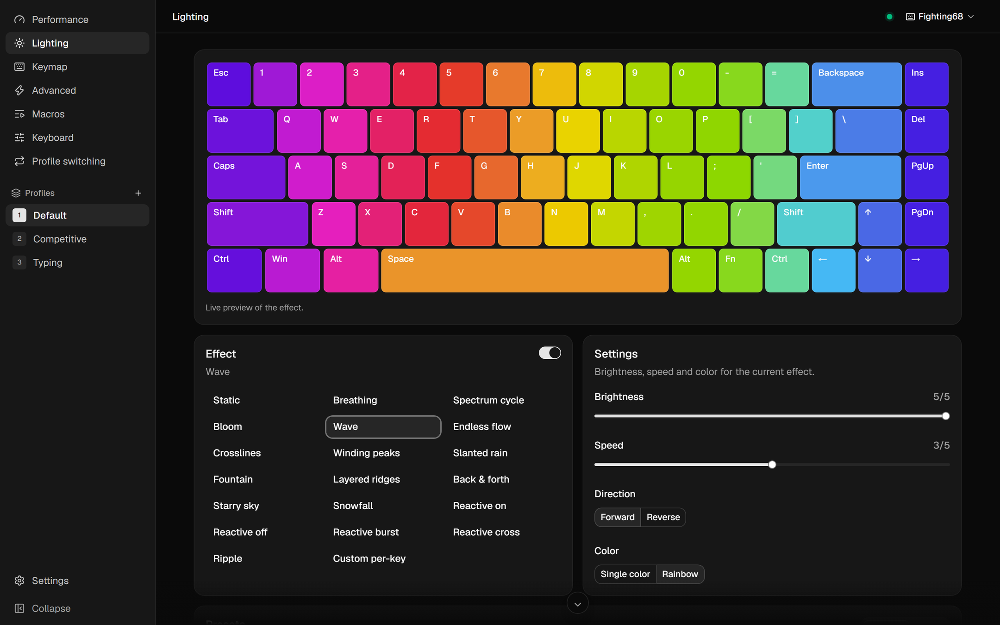
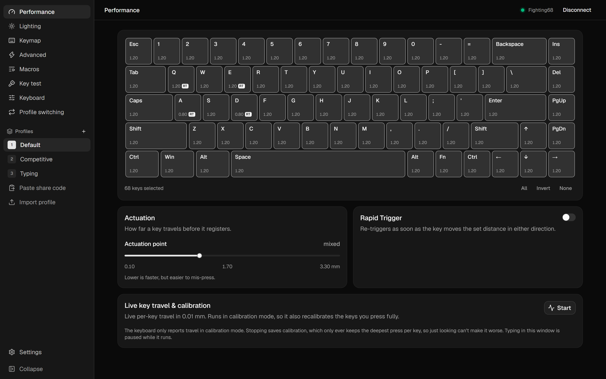
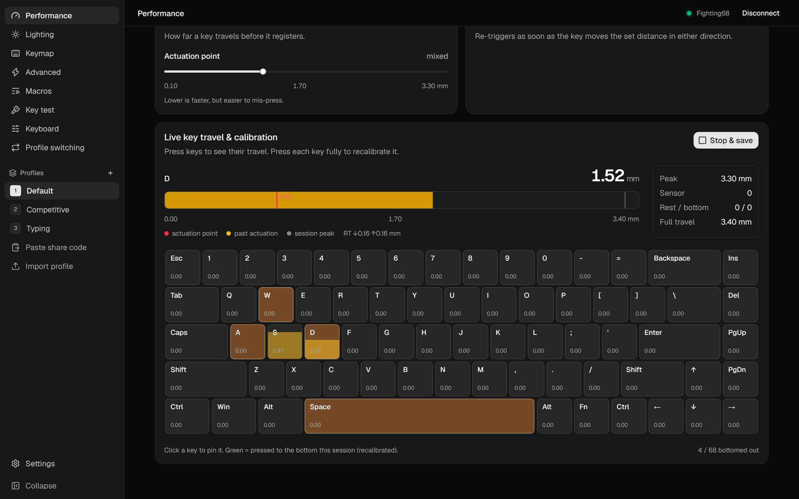
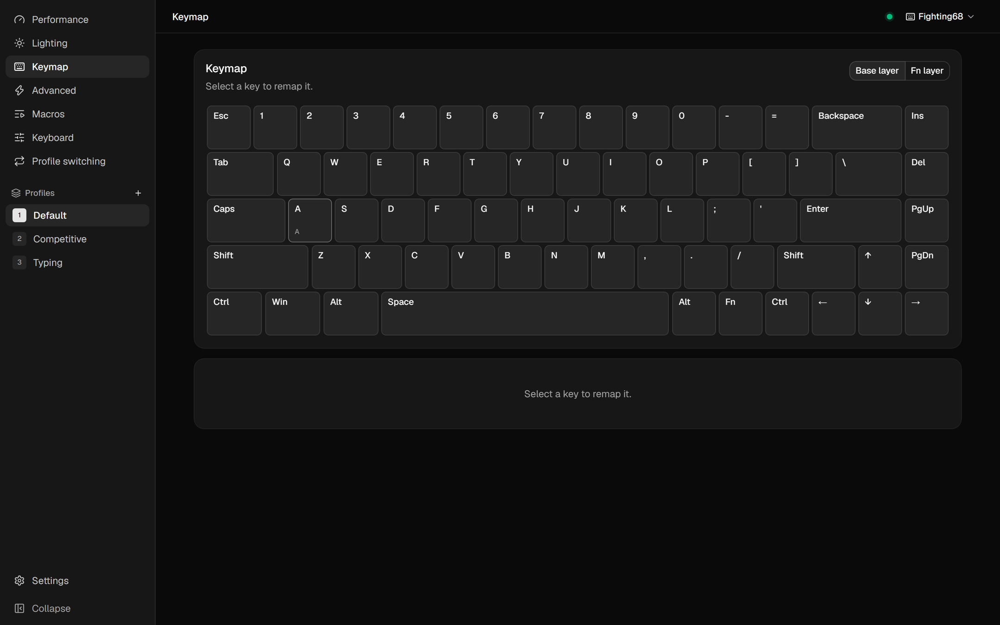
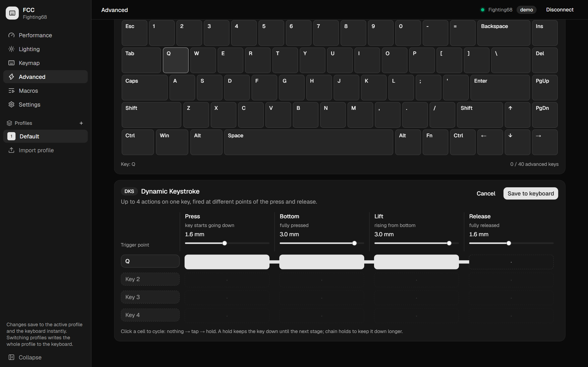

<div align="center">

# Fighting Control Center

**A fast, modern configurator for Hall-effect keyboards** · *early development*



Rapid trigger · Live key travel · Lighting · Remapping · Advanced keys · Macros · Profiles

[Download](../../releases/latest) · [Supported keyboards](#supported-keyboards) · [Report your keyboard](#report-your-keyboard) · [Build from source](#build-from-source)

</div>

## What it is

One app instead of a different slow web driver for every brand. FCC talks to the keyboard directly over USB using each
maker's own protocol (reverse-engineered and documented in [docs/](docs/)), and adds what a desktop app should have:

- **Unlimited profiles**, switched from the sidebar, the tray, global hotkeys (Ctrl+Alt+1…9) or **automatically when a
  game is focused**, and back when you leave it. Only what differs is rewritten, so switching is near-instant.
- **Live key travel** in 0.01 mm, per-key actuation, rapid trigger (press / release / continuous), SOCD, Dynamic
  Keystroke, Mod-Tap, Toggle and Rappy Snappy.
- **Lighting** with a live on-screen preview, per-key painting and 16 built-in designs.
- **Remapping and macros**: keys, combos, media and mouse buttons; macros recorded with real delays and editable.
- Tray icon, start with Windows, automatic updates. Windows app (~2 MB) or a web version for Chrome / Edge.

<table>
  <tr>
    <td></td>
    <td></td>
  </tr>
  <tr>
    <td></td>
    <td></td>
  </tr>
</table>

## Install

**Windows:** download `Fighting Control Center_x64-setup.exe` from [Releases](../../releases/latest) and run it. It
isn't code-signed yet, so SmartScreen may warn you: *More info → Run anyway*. The app updates itself from then on.

**Portable:** `FCC-portable-<version>.zip`, unzip anywhere and run the exe.

Profiles and settings live in `%APPDATA%\Fighting Control Center\settings.json`, so reinstalling or deleting a portable
copy keeps them. An empty `portable.txt` next to the exe keeps everything beside it instead (`FCC-data`).

**No keyboard handy?** Click **Try demo mode** for a simulated board.

## Supported keyboards

| | Boards | What works |
|---|---|---|
| ✅ Verified | **Fighting68 HE** (`0c45:8030`) | Everything, tested end to end |
| ⚠️ Untested | ~135 **Sonix** boards: AULA F65, Ajazz AK820 MAX, EWEADN BAT68, MCHOSE, Looting, Epomaker HE80, LEOBOG… | Everything; same firmware family as the Fighting68 |
| ⚠️ Untested | ~285 **RongYuan RY5088** boards: MonsGeek FUN60 / FUN68 / M1 V5 HE, Akko MOD007B HE… | Everything, over MonsGeek's own protocol |
| ⚠️ Untested | 28 **MCHOSE** boards: ACE 60 / 68 / 75, JET 75, ZERO 75X, MIX 87… | All but DKS, SOCD and live travel (for now) |
| 🧪 Experimental | **Royal Kludge M75** family | Keymap, lighting, per-key RGB, sleep (not a Hall-effect board) |
| 🧪 Experimental | 19 **Razer** keyboards: Huntsman V2 / V3 Pro / Mini, BlackWidow V3 / V4… | Lighting, per-key RGB, game mode, polling rate. Desktop app only; close Synapse first |
| ⛔ Not yet | Wireless 2.4 GHz dongles | Use the USB cable |

Untested boards are detected automatically and open **read-only** until you choose *Allow changes*. The full list with
USB ids is in [docs/DEVICES.md](docs/DEVICES.md).

## Report your keyboard

Tried FCC on a board that isn't verified? Open **Settings → Report this keyboard** and press **Open GitHub issue**. The
report holds the USB id, firmware and settings read from the board (no macro contents); tick what worked and submit.
That's all it takes to get a board verified or fixed.

## Safety

FCC writes to your keyboard's memory, so it's deliberately careful:

- Only commands the official software itself sends. **No firmware-flashing code.**
- Every write waits for the keyboard's acknowledgement; values are clamped to the board's limits.
- A full backup is taken on every connect, and factory reset is one click away.

## Build from source

Node.js 20+; for the desktop app also Rust and the Microsoft C++ build tools.

```bash
git clone https://github.com/shybruh/FightingControlCenter-FCC.git
cd FightingControlCenter-FCC
npm --prefix app install
npm --prefix app run dev              # web version on http://localhost:5174
npm --prefix app run desktop          # desktop app with hot reload
npm --prefix app run desktop:build    # release build + installer
npm --prefix app test                 # catalog and protocol checks, no keyboard needed
```

React 19 · TypeScript · Vite · Tailwind CSS 4 · zustand · Tauri 2 (Rust, hidapi) · WebHID. Protocol notes per brand are
in [docs/](docs/); `tools/report/decode.js` reads board reports from issues.

## Credits & license

The RongYuan driver started from **monsgeek-akko-linux**'s notes, the Royal Kludge packet layout from **Rangoli** and
**Kludge Knight**, the Razer command set from **OpenRazer** and Razer key positions from **OpenRGB**. FCC's
implementations are its own.

FCC is an independent project, not affiliated with any keyboard brand listed here. Use it at your own risk.
Licensed under the [GNU GPL v3.0 or later](LICENSE).
